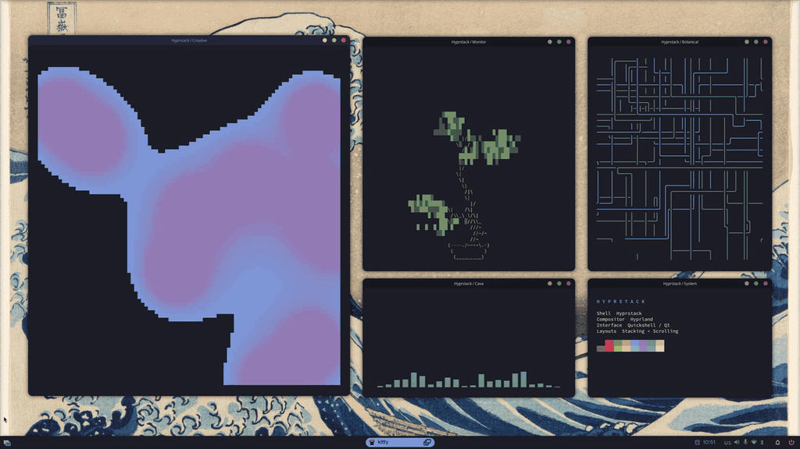
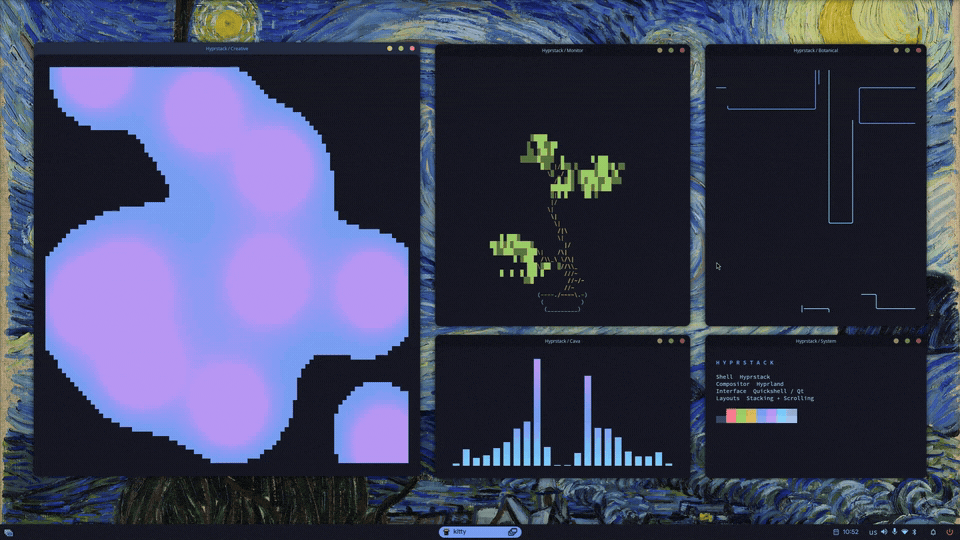
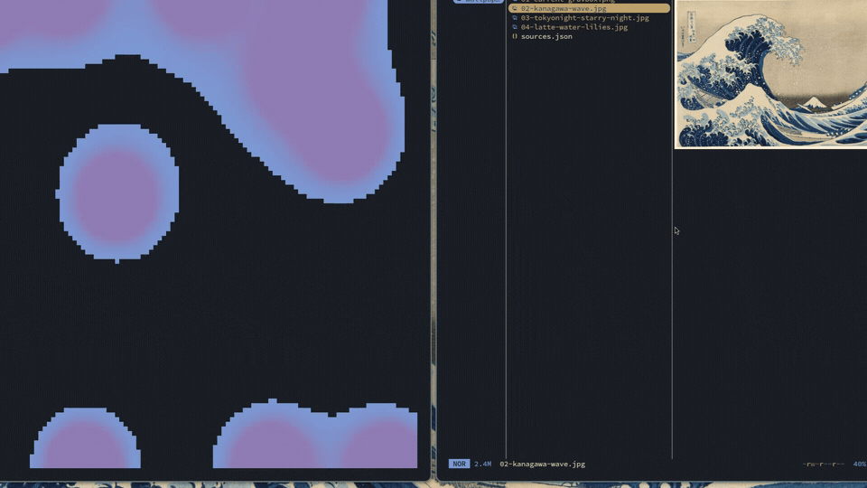
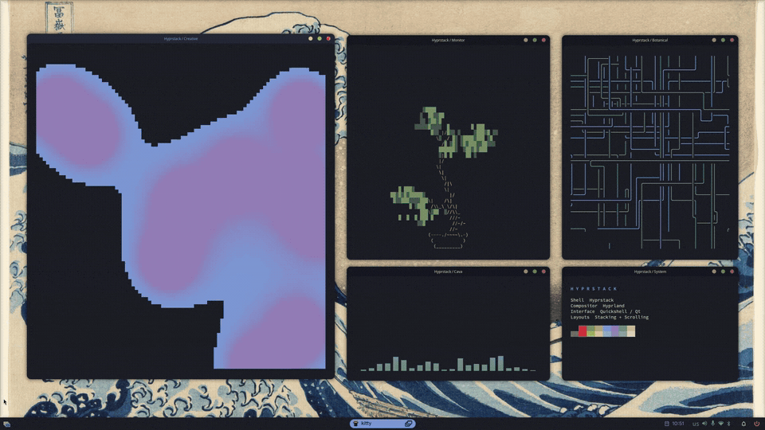
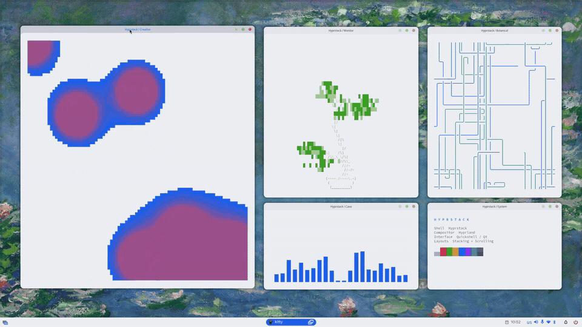

[Русский](README.md)

  

<h1 align="center">Hyprstack</h1>

Two ways to work with windows. One desktop shell for Hyprland.

  <a href="INSTALL.en.md">Installation</a> ·
  <a href="CONFIGURATION.md">Configuration (RU)</a> ·
  <a href="#demo">Demo</a>

Hyprstack combines scrolling tiling with a familiar floating desktop.
Switch between them with a single shortcut: each mode remembers your window
layout. The taskbar, launcher, notifications and settings share a consistent
interface.

The shell uses QML and C++ with Quickshell. Hyprland integration uses Lua and
a native extension. Russian is the default interface language; English and the
system language are available in settings.

## See it in action

Kanagawa, Tokyo Night and Catppuccin Latte. Switch between floating windows
and scrolling tiling with `Super+Ctrl+Shift+M`.

<table>
  <tr>
    <td align="center" width="50%"> Stacking · arrange windows freely</td>
    <td align="center" width="50%"> Scrolling · navigate the window strip</td>
  </tr>
  <tr>
    <td align="center"> Three themes · one desktop</td>
    <td align="center"> Overview · every window in sight</td>
  </tr>
</table>

## Features

- **Scrolling and stacking.** A keyboard-driven window strip and a floating mode
  with titlebars, minimise and maximise controls. Window sizes and positions
  are restored when switching modes. In tiling, focus follows the pointer by
  default: hover over a window to focus it.
- **Overview.** Window and workspace previews, window selection and workspace
  navigation. Stacking also provides an Alt+Tab switcher with thumbnails.
- **Taskbar.** Application groups, pinned apps, window previews, workspaces and
  a system tray, with configurable items and placement.
- **Search and launch.** Applications, calculator, clipboard history, themes
  and wallpapers.
- **Notifications.** History, grouping, actions and Do Not Disturb.
- **System controls.** Audio, microphone, networking, Bluetooth, media players,
  screenshots and recording. Features depend on available services and devices.
- **Dashboard.** Calendar, media controls and system status. Weather is opt-in,
  with city selection and two providers.
- **Appearance.** 18 built-in colour themes, light and dark modes, accents,
  interface scaling, gaps, corners, transparency and animations.
- **Lock and authentication.** Screen locking through a system PAM service
  and a themed, built-in Polkit agent.

## Requirements and compatibility

Current source version: **1.1.1**.

| Component | Requirement |
| --- | --- |
| Session | Linux, Wayland, **Hyprland 0.56.2** |
| Shell runtime | **Quickshell ≥ 0.3.1**, with Hyprland, PAM and Polkit modules |
| Qt | **6.9 or newer**, including matching Qt Quick private headers |
| Build tools | CMake ≥ 3.22, Ninja, pkg-config, a C++23 compiler |
| Helpers | Python ≥ 3.10, Pillow, gettext |

Build the native extension on the target computer against its installed Hyprland.
Version **0.56.2 is required**: a newer compositor is not automatically compatible.
Rebuild after an ABI change; do not reuse `.so` files from another system.

Build and graphical checks have been run on CachyOS. Dependency instructions
are provided for other distributions; a complete installation has not yet been
verified on each one. Repositories with another Hyprland version or an older Qt
require a compatible stack first.

## Installation

1. Prepare dependencies for your system:
   [Arch / CachyOS / EndeavourOS / Manjaro](INSTALL.en.md#arch),
   [Fedora](INSTALL.en.md#fedora), [Debian / Ubuntu](INSTALL.en.md#debian-ubuntu)
   or [openSUSE](INSTALL.en.md#opensuse).
2. Check the Hyprland, Quickshell and Qt versions.
3. Download this repository and build Hyprstack as your regular user.
4. Back up your configuration, copy the files and log into Hyprland.
5. Run `hyprstack-doctor` and choose your preferred applications.

**Follow the commands in [INSTALL.en.md](INSTALL.en.md), in order.**

Fonts, Material Symbols and M3Shapes are included.  Weather, blur and the audio visualiser
are disabled by default.

## Getting started

| Shortcut | Action |
| --- | --- |
| `Super+Ctrl+Shift+M` | Switch scrolling / stacking |
| `Super` | Open the dashboard |
| `Super+D` | Application launcher |
| `Super+O` | Window and workspace overview |
| `Super+Return` | Terminal |
| `Super+H` / `Super+L` | Adjacent window in scrolling |
| `Super+J` / `Super+K` | Adjacent workspace |
| `Super+Alt+Space` | Toggle a floating window |
| `Alt+Tab` | Window switcher in stacking |
| `Super+Q` | Close the window |
| `Ctrl+Super+L` | Lock the session |

`Super` usually means the Windows logo key. Shortcuts and default applications
are configurable; the shell settings contain the full list. To switch the
interface to English, open **Язык и регион → Язык интерфейса** and select English.

## Documentation

- [Installation and distribution dependencies](INSTALL.en.md)
- [Configuration, shortcuts, themes and weather (Russian)](CONFIGURATION.md)
- [Updates, diagnostics and manual removal (Russian)](MAINTENANCE.md)
- [Third-party components and licences](THIRD_PARTY.md)

## Credits and licence

The interface builds on [Caelestia shell](https://github.com/caelestia-dots/shell).
The project uses [Quickshell](https://quickshell.org/),
[Hyprland](https://hypr.land/), a modified hyprbars and
[M3Shapes](https://github.com/soramanew/m3shapes).

The main licence is [GPL-3.0](LICENSE). Bundled component and font licences
and their origins are preserved in [THIRD_PARTY.md](THIRD_PARTY.md).
