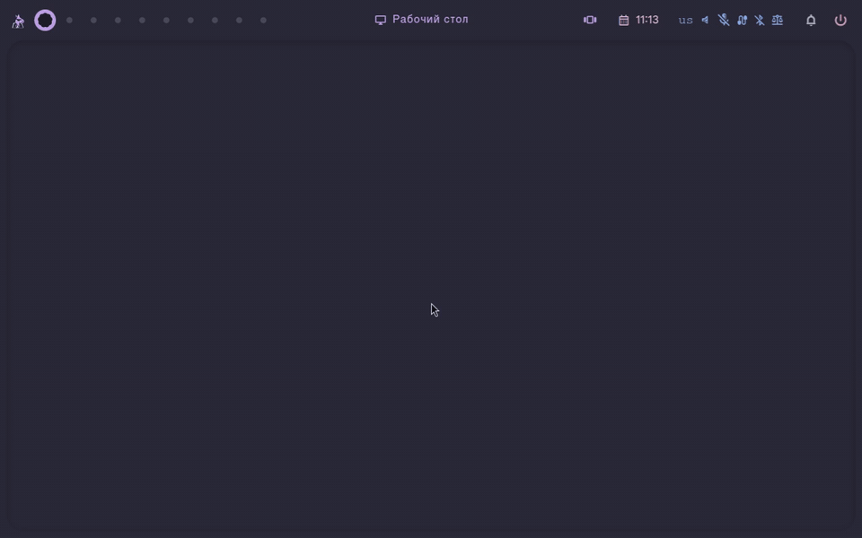
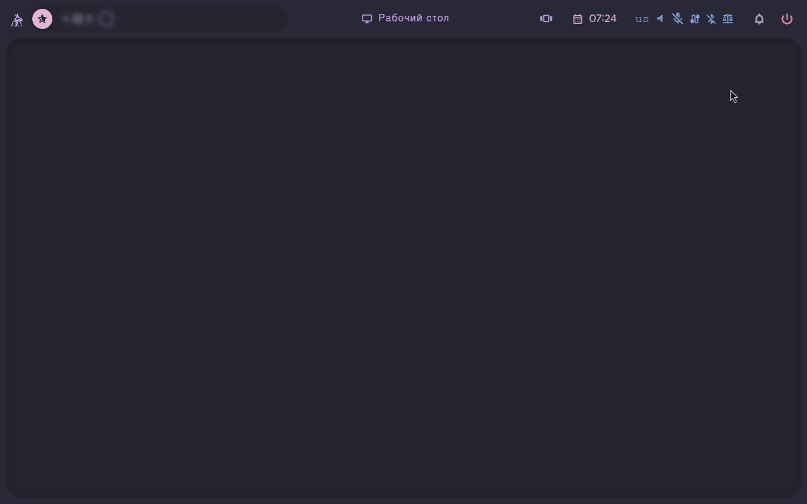
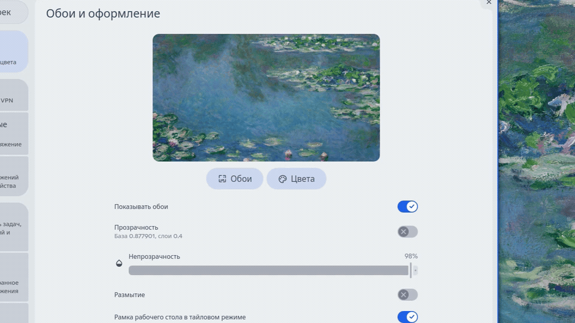
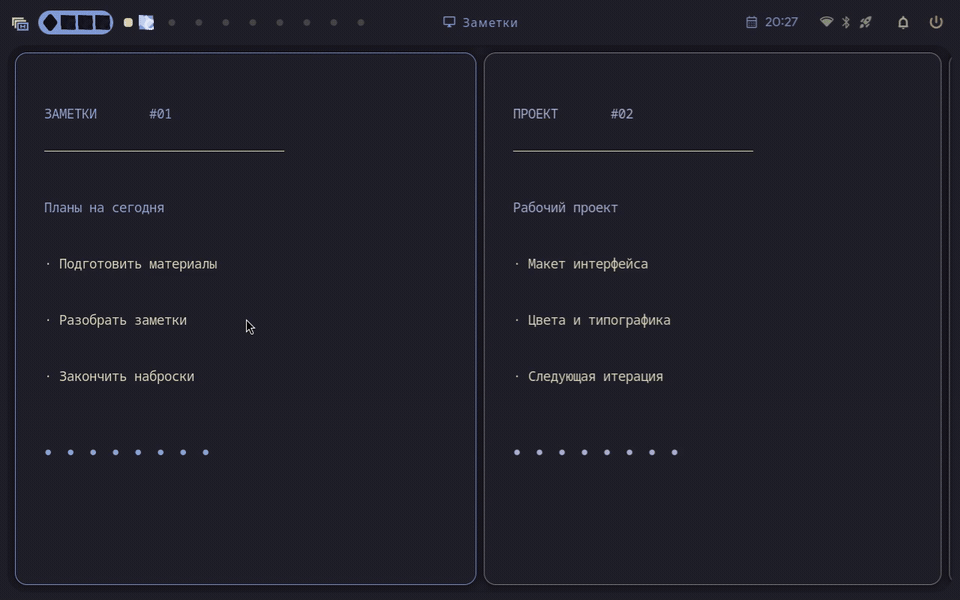

[English](README.en.md)

  

<h1 align="center">Hyprstack</h1>

Два способа работать с окнами. Одно рабочее окружение для Hyprland.

  <a href="INSTALL.md">Установка</a> ·
  <a href="MAINTENANCE.md#обновление">Обновление</a> ·
  <a href="CONFIGURATION.md">Настройки и клавиши</a> ·
  <a href="#demo">Демонстрация</a>

Hyprstack объединяет скроллинг-тайлинг и привычный рабочий стол с плавающими окнами.
Переключайтесь между ними одним сочетанием клавиш: расположение окон в каждом
режиме сохраняется. Панель задач, запуск приложений, уведомления и настройки
оформлены как части одного интерфейса.

Оболочка написана на QML и C++ с использованием Quickshell. Интеграция с Hyprland
использует Lua и собственный нативный модуль. Русский язык включён по умолчанию;
английский и язык системы можно выбрать в настройках.

## Как это выглядит

Kanagawa, Tokyo Night и Catppuccin Latte. Из плавающих окон в скроллинг-тайлинг
и обратно — `Super+Ctrl+Shift+M`.

<table>
  <tr>
    <td align="center" width="50%"> Дашборд · календарь, медиа и виджеты</td>
    <td align="center" width="50%"> Панель задач · уведомления и быстрые действия</td>
  </tr>
  <tr>
    <td align="center"> Настройки · прозрачность, тени и масштаб</td>
    <td align="center"> Обзор пространства · все окна перед глазами</td>
  </tr>
</table>

Три пальца — прокрутка, четыре — открытие и закрытие обзора.
[Видео MP4 · 1280×800 · 60 кадров/с](docs/media/trackpad-swipes.mp4).
Записано в работающем Hyprstack с эмулируемым вводом; точки показывают касания.

## Возможности

- **Scrolling и stacking.** Лента окон с управлением с клавиатуры и режим
  плавающих окон с заголовками, сворачиванием и развёртыванием. Размеры и
  расположение восстанавливаются при переключении. В тайлинге фокус по умолчанию
  следует за курсором: достаточно навести его на окно.
- **Обзор пространства.** Миниатюры окон и рабочих столов, выбор окна и переход
  между рабочими пространствами. В stacking доступен Alt+Tab с миниатюрами.
- **Панель задач.** Группировка приложений, закрепление, превью окон, рабочие
  столы и системный трей. Состав и расположение элементов настраиваются.
- **Поиск и запуск.** Приложения, калькулятор, буфер обмена, выбор темы и обоев.
- **Уведомления.** История, группировка, действия и режим «Не беспокоить».
- **Управление системой.** Звук, микрофон, сеть, Bluetooth, медиаплееры,
  снимки экрана и запись. Доступность функций зависит от установленных служб
  и устройств.
- **Дашборд.** Календарь, медиаплеер и состояние системы. Погода включается
  отдельно; доступны выбор города и два провайдера.
- **Оформление.** 18 встроенных цветовых тем, светлый и тёмный режимы,
  акценты, масштаб интерфейса, отступы, скругления, прозрачность и анимации.
- **Блокировка и авторизация.** Экран блокировки через системный PAM-сервис
  и встроенный агент Polkit в стиле оболочки.

## Требования и совместимость

Текущая версия исходников: **1.1.1**.

| Компонент | Требование |
| --- | --- |
| Сеанс | Linux, Wayland, **Hyprland 0.56.2** |
| Оболочка | **Quickshell ≥ 0.3.1**, с модулями Hyprland, PAM и Polkit |
| Qt | **6.9 или новее**, включая соответствующие приватные заголовки Qt Quick |
| Сборка | CMake ≥ 3.22, Ninja, pkg-config, компилятор C++23 |
| Служебные команды | Python ≥ 3.10, Pillow, gettext |

Нативный модуль собирается на компьютере пользователя под установленный Hyprland.
Версия **0.56.2 обязательна**: более новый композитор не считается автоматически
совместимым. После изменения ABI нужна пересборка; готовые `.so` из чужой системы
использовать не следует.

Поддерживаемые системы: **Arch Linux и Arch-based дистрибутивы**
(CachyOS, EndeavourOS, Manjaro), а также **NixOS**. Сборка и графические проверки
выполнялись на CachyOS. Для NixOS предусмотрены пакет и модули NixOS/Home Manager
с единым набором зависимостей. Наличие нужных версий проверяется во всех случаях;
принадлежность к семейству Arch не гарантирует совместимость любой ветки пакетов.
Fedora, Debian/Ubuntu и openSUSE в поддерживаемые платформы не входят.

## Установка

1. Подготовьте зависимости по инструкции для своей системы:
   [Arch / CachyOS / EndeavourOS / Manjaro](INSTALL.md#arch)
   или [NixOS](INSTALL.md#nixos).
2. Проверьте версии Hyprland, Quickshell и Qt.
3. На Arch-based системах скачайте исходники и соберите Hyprstack под обычным
   пользователем. На NixOS подключите пакет и модуль своей Nix-конфигурации.
4. Сделайте резервную копию конфигурации, разместите файлы и войдите в Hyprland.
5. Выполните `hyprstack-doctor` и настройте приложения под себя.

**Все команды по порядку: [INSTALL.md](INSTALL.md).**

Для обновления завершите Hyprland и выполните `./update.sh` из каталога
исходников в TTY. Сборка, резервная копия и сохранение настроек выполняются
автоматически. [Короткая инструкция](MAINTENANCE.md#обновление).

В исходники включены шрифты, Material Symbols и M3Shapes. Разрешение, расположение и масштаб экранов по умолчанию выбирает
Hyprland; собственные настройки пользователь хранит отдельно. Погода, размытие
и звуковой визуализатор по умолчанию отключены.

## Первые действия

| Сочетание | Действие |
| --- | --- |
| `Super+Ctrl+Shift+M` | Переключить scrolling / stacking |
| `Super` | Открыть дашборд |
| `Super+D` | Запуск приложений |
| `Super+O` | Обзор окон и рабочих столов |
| `Super+Return` | Терминал |
| `Super+H` / `Super+L` | Соседнее окно в scrolling |
| `Super+J` / `Super+K` | Соседний рабочий стол |
| `Super+Alt+Space` | Переключить плавающее состояние окна |
| `Alt+Tab` | Переключатель окон в stacking |
| `Super+Q` | Закрыть окно |
| `Ctrl+Super+L` | Заблокировать сеанс |

`Super` — обычно клавиша с логотипом Windows. Все сочетания и приложения
по умолчанию можно изменить; полный список есть в настройках оболочки.

На тачпаде в scrolling три пальца влево/вправо плавно прокручивают колонки,
вверх/вниз — рабочие столы. Четыре пальца вверх открывают обзор, вниз —
подтверждают выбор и закрывают его. [Настройка жестов](CONFIGURATION.md#жесты-тачпада).

## Документация

- [Установка на Arch-based системах и NixOS](INSTALL.md)
- [Настройки, горячие клавиши, темы и погода](CONFIGURATION.md)
- [Обновление, диагностика и ручное удаление](MAINTENANCE.md)
- [Сторонние компоненты и лицензии](THIRD_PARTY.md)

## Благодарности и лицензия

Интерфейс развивается на основе [Caelestia shell](https://github.com/caelestia-dots/shell).
Проект использует [Quickshell](https://quickshell.org/),
[Hyprland](https://hypr.land/), изменённый hyprbars и
[M3Shapes](https://github.com/soramanew/m3shapes).

Основная лицензия — [GPL-3.0](LICENSE). Лицензии включённых компонентов,
шрифтов и сведения об их происхождении сохранены в [THIRD_PARTY.md](THIRD_PARTY.md).
